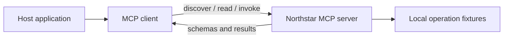

# Model Context Protocol

This repository teaches the Model Context Protocol as the standard layer between LLM hosts, clients, and tool servers. The notebooks use the official MCP Python SDK to build and inspect a local server that exposes tools, resources, and prompts.

The lesson follows the custom agents repository by moving one layer down: agents decide when to use tools, while MCP defines how those tools are discovered, described, invoked, and secured.

## Learning Objectives

By the end of this repository, you should be able to:

- Build an MCP server that exposes tools for an LLM agent to call.
- Connect an LLM-style client workflow to external systems through MCP.
- Define and validate MCP tool, resource, and prompt schemas.
- Explain the host-client-server architecture and JSON-RPC discover-then-invoke flow.
- Compare stdio, Streamable HTTP, and legacy SSE transport patterns.
- Identify MCP security risks and choose least-privilege mitigations.

## Learning Path



| File / Folder | Description |
|---|---|
| [**01 - MCP Architecture and Protocol**](01-mcp-architecture-and-protocol.ipynb) | Motivate MCP, map host/client/server roles and primitives, read the JSON-RPC messages behind a tool call, and tell protocol errors from tool errors. |
| [**02 - Building a Local MCP Server**](02-building-a-local-mcp-server.ipynb) | See how the Python SDK turns decorated functions into a tool, a resource, and a prompt with generated schemas, then test where a tool call can fail. |
| [**03 - Client Discovery and Tool Invocation**](03-client-discovery-and-tool-invocation.ipynb) | Connect through a real stdio client, list and use every primitive, and pass tool errors on to the model as results. |
| [**04 - Transports, Auth, and Security**](04-transports-auth-and-security.ipynb) | Compare stdio and Streamable HTTP, follow how a remote server authorizes requests, and match MCP risks to host and server controls. |

### Additional Folders and Files

| File / Folder | Description |
|---|---|
| [**assets**](assets/) | Visual aids referenced in the repository. |
| [**data**](data/) | Small local fixtures that stand in for filesystem, API, and database systems. |
| [**support**](support/) | Shared helpers, stdio server entry point, and focused tests. |
| [**pyproject.toml**](pyproject.toml) | Project configuration and dependencies. |
| [**uv.lock**](uv.lock) | Dependency lock file. |

## Setup

Use [uv](https://docs.astral.sh/uv/getting-started/installation/) 0.13.5 or newer
and Python 3.13.17 or a newer 3.13 patch release, as defined in
[`.python-version`](.python-version).

> [!NOTE]
> Throughout these steps, text in angle brackets like `<repo-name>` is a **placeholder**. Replace it, including the `< >` brackets, with your own value. For example, `cd <repo-name>` becomes `cd mle-model-context-protocol`.

### 1. Create the Repository from the Template

Click **Use this template** on GitHub.

When creating the repository:

- Set yourself as the **Owner**
- Choose a repository name
- Disable **Include all branches**
- Click **Create repository**

> [!IMPORTANT]
> If you are working in pairs or groups, only **one person** should complete this step.

---

### 2. Add Collaborators (Pairs/Groups Only)

If working with teammates:

1. Open the repository on GitHub
2. Go to **Settings → Collaborators**
3. Add your teammates as collaborators
4. Share the repository link with your team

Teammates should accept the invitation before continuing.

---

### 3. Clone the Repository

Copy the SSH URL from the **Code** button on GitHub, then run:

```bash
git clone <copied-ssh-url>
```

The copied SSH URL will look like `git@github.com:<your-username>/<repo-name>.git`.

---

### 4. Move into the Project Folder and Install Dependencies

The command below installs all dependencies and creates a virtual environment in `.venv/`.

```bash
cd <repo-name>
uv sync
```

---

### 5. Open the Repository in VS Code

> [!NOTE]
> Make sure you open VS Code from the project root so it automatically detects the environment created by `uv sync`.

Launch VS Code in the project root folder:

```bash
code .
```

Then open a notebook and select the Python environment created by `uv sync` as the kernel.
